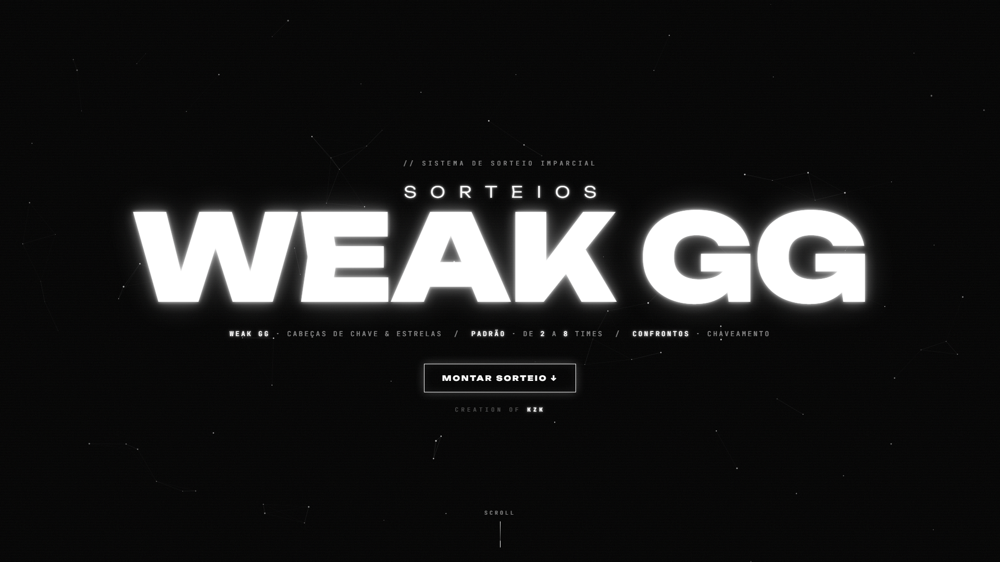
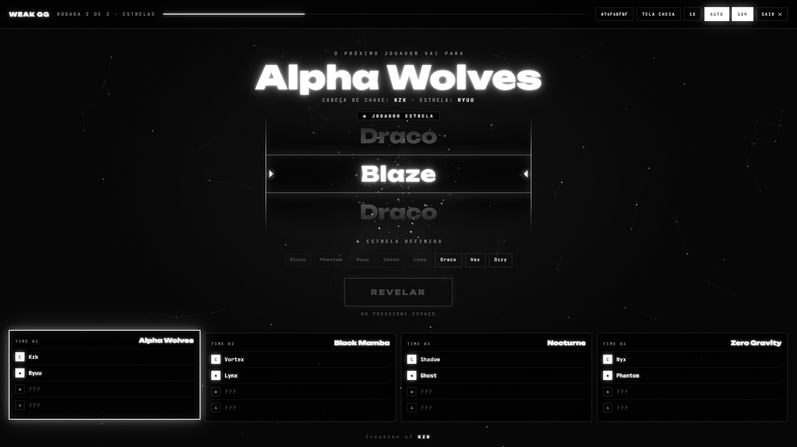
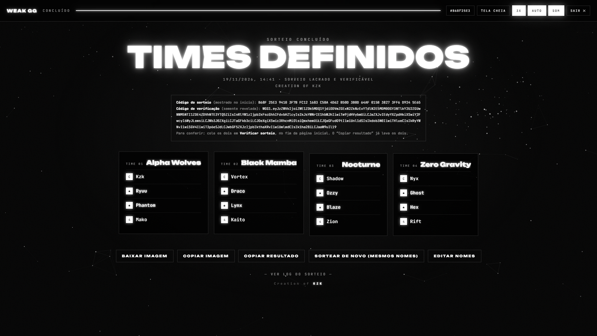
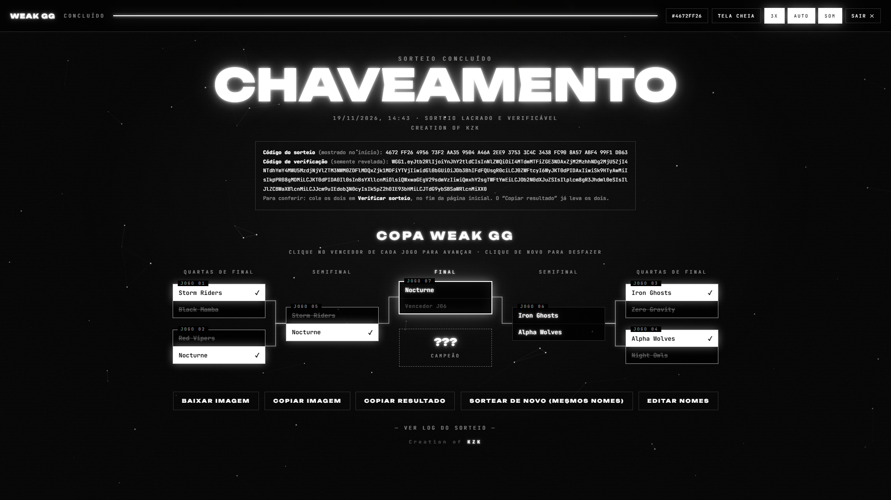

# Sorteios WEAK GG

Sorteio de times ao vivo, com suspense de transmissão e resultado **lacrado e verificável**.
Feito para campeonatos e partidas entre amigos: cabeças de chave e estrelas para equilibrar
os times, sorteio padrão de 2 a 8 times e chaveamento eliminatório de até 32 times.

**Creation of KZK** — Kauã de Araújo Rocha



## O que a página faz

| Modo | Para quê | Como funciona |
|---|---|---|
| **WEAK GG** | 4 times equilibrados | Cada time tem 1 cabeça de chave (definido por você), 2 estrelas e 1 jogador sorteados |
| **Padrão** | Dividir uma lista em times | De 2 a 8 times, até 64 nomes; um jogador por time a cada rodada |
| **Confrontos** | Montar um campeonato | De 2 a 32 times sorteados num chaveamento eliminatório, com folgas quando preciso |

Em todos os modos:

- **Sorteio com suspense:** roleta que desacelera, batimento cardíaco, tela escurecendo, efeitos
  de luz e partículas em preto e branco.
- **Lacre verificável:** antes de revelar qualquer nome, a página mostra o *código do sorteio*
  (SHA-256). No final revela a semente, e qualquer pessoa confere em **Verificar sorteio** que
  nada foi trocado. Detalhes em [docs/verificacao.md](docs/verificacao.md).
- **Controles do palco:** revelar no clique ou no **Auto**, velocidade **1x / 1,5x / 2x / 3x**,
  tela cheia para transmissão, som liga/desliga.
- **Resultado pronto para compartilhar:** imagem (baixar ou copiar e colar no Discord) e texto
  com os times ou os jogos, já com os códigos de verificação.
- **Chaveamento jogável:** clique no vencedor de cada jogo para ele avançar até o campeão; o
  último chaveamento fica salvo e pode ser reaberto.
- **Nada vai para servidor:** os nomes ficam só no navegador de quem está sorteando.

Passo a passo de cada modo em [docs/como-funciona.md](docs/como-funciona.md).

| Sorteio ao vivo | Resultado |
|---|---|
|  |  |



## Rodar no computador

É um site estático, sem build e sem dependências. O lacre usa a Web Crypto do navegador, que só
funciona em `https` ou em `localhost`, então abra por um servidor local em vez de clicar duas
vezes no arquivo:

```bash
python -m http.server 8000
```

Depois acesse `http://localhost:8000`.

## Publicar

O site está pronto para a Vercel (ou qualquer hospedagem de arquivos estáticos).
Passo a passo, prévia do link no Discord e domínio próprio em [docs/deploy.md](docs/deploy.md).

## Estrutura

```
index.html                 página (marcação) — carrega os arquivos abaixo
assets/
  css/
    base.css               cores, camadas do fundo, cursor, botões
    home.css               abertura, letreiros, seções, formulário, rodapé
    stage.css              palco do sorteio, roleta, quadros dos times, tela final
    modes.css              abas, modo Padrão e chaveamento
    overlays.css           janelas, verificação, lacre, efeitos por cima
    responsive.css         tablet, celular e movimento reduzido (sempre por último)
  js/                      carregados nesta ordem, compartilham as mesmas declarações
    core.js                utilidades, aleatoriedade, lacre e plano do sorteio
    effects.js             texto embaralhado, som sintetizado, partículas, cursor, scroll
    setup-weakgg.js        formulário WEAK GG, nomes salvos, colar lista
    setup-padrao.js        abas e formulário do modo Padrão
    setup-confrontos.js    formulário do modo Confrontos
    draw.js                motor do sorteio: lacre, rodadas, roleta, revelação, final
    bracket.js             chaveamento: desenho, linhas, vencedores, reabrir
    stage-controls.js      botões e teclas do palco, copiar resultado, tela cheia
    export.js              imagem do resultado (PNG)
    verify.js              verificação de um sorteio antigo
  img/
    og.png                 prévia do link (Open Graph)
docs/
  como-funciona.md         uso de cada modo
  verificacao.md           como o lacre e a verificação funcionam
  deploy.md                publicação na Vercel
  screenshots/             prints usados neste README
```

## Atalhos no palco

| Tecla | Ação |
|---|---|
| Espaço / Enter | Revelar |
| V | Mudar a velocidade |
| F | Tela cheia |
| Esc | Sair |

## Como foi feito

Projeto idealizado, especificado e testado por mim, desenvolvido com um agente de IA
(Claude Code) a partir de prompts, revisão de cada entrega e feedback iterativo.
